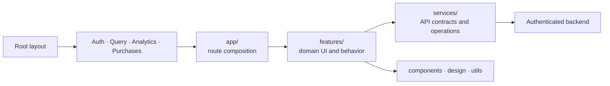

<p align="center">
  
</p>

<h1 align="center">Beauty Ally</h1>

<p align="center">
  A production Expo application for scanning cosmetics, organizing skincare products, and building a personal routine.
</p>

<p align="center">
  <a href="https://beautyally.app/en">Website</a> ·
  <a href="https://apps.apple.com/app/id6749963321">App Store</a> ·
  <a href="https://play.google.com/store/apps/details?id=com.sycrafted.beautyai">Google Play</a>
</p>

> [!IMPORTANT]
> **Portfolio snapshot:** this repository is a reviewable snapshot of the production Beauty Ally mobile client, not a standalone application template. The production API is private and no public development endpoint is currently available, so a fresh clone cannot run the complete product end-to-end. The source is published to demonstrate the product and its engineering architecture; normal external contributions are temporarily limited for the same reason.

## About the project

Beauty Ally helps users photograph or import a cosmetic product, receive a personalized informational summary based on their skin profile, and keep the products they use in one organized place.

This repository contains the React Native mobile client used by the published iOS and Android application. The production backend and third-party service credentials are intentionally not included.

Beauty Ally is an informational product, not a medical device. Its output is not medical advice, diagnosis, or a safety determination.

## Product capabilities

- Camera, gallery, and share-extension scan flows, including front-and-ingredients photo analysis.
- Personalized scan results with usage guidance and routine compatibility insights.
- Searchable scan history and favorites.
- A morning/evening skincare shelf with scheduling, reordering, completion tracking, editing, and purchase links.
- Guided skin-profile onboarding and profile editing.
- Monthly and yearly subscriptions backed by RevenueCat entitlements.
- Localized UI for 13 locales, including Arabic, Chinese, Hindi, Japanese, Korean, Ukrainian, and Russian.
- Consent-aware analytics, error reporting, scheduled local reminders, and deep-link handling.

## Engineering highlights

- Expo Router composition roots stay focused on routing and screen assembly; domain behavior lives in feature modules.
- TanStack Query owns server state, cache invalidation, infinite queries, and mutation lifecycles.
- A centralized authenticated API client provides timeouts, cancellation, JSON handling, normalized errors, and request tracing.
- Zod validates backend responses at runtime before untrusted data reaches the UI.
- Analytics events and properties are typed, centralized, and constrained to non-sensitive data.
- Subscription state is modeled independently from RevenueCat SDK orchestration.
- Progressive image loading, virtualized collections, and isolated animations keep image-heavy screens responsive.
- CI runs formatting, ESLint, TypeScript, and the Jest test suite on every push and pull request.

## Architecture



| Path             | Responsibility                                                     |
| ---------------- | ------------------------------------------------------------------ |
| `app/`           | Expo Router layouts and screen composition roots                   |
| `features/`      | Feature-owned components, hooks, models, and tests                 |
| `services/`      | Backend operations, API client, errors, and Zod contracts          |
| `components/ui/` | Reusable, domain-agnostic UI primitives                            |
| `design/`        | Responsive tokens and scaling helpers                              |
| `utils/`         | Cross-cutting utilities, i18n, analytics, and query infrastructure |
| `assets/`        | Images, icons, animations, sounds, and bundled fonts               |

## Technology

| Area             | Stack                                                                              |
| ---------------- | ---------------------------------------------------------------------------------- |
| Runtime          | Expo SDK 58, React Native 0.88, React 19, TypeScript                               |
| Navigation       | Expo Router, React Navigation                                                      |
| Data             | TanStack Query, Zod, Fetch API                                                     |
| Authentication   | Clerk                                                                              |
| Subscriptions    | RevenueCat                                                                         |
| Styling          | NativeWind, Tailwind CSS, responsive design tokens                                 |
| Motion and media | Reanimated, Worklets, Gesture Handler, Expo Camera, Expo Image, Expo Video, Lottie |
| Observability    | PostHog, Sentry                                                                    |
| Quality          | Jest, React Native Testing Library, ESLint, Prettier, GitHub Actions               |

## Local development

### Prerequisites

- Node.js `24.3.0` (the repository includes `.nvmrc`)
- npm
- Xcode for iOS or Android Studio for Android
- A compatible backend plus development credentials for Clerk, RevenueCat, and PostHog

### Setup

```bash
nvm use
npm ci
cp .env.example .env.local
```

Fill in `.env.local`, then create the native development build for your target platform:

```bash
npm run ios
# or
npm run android
```

After the development client is installed, start Metro with:

```bash
npm start
```

This application uses native modules and is intended to run in a development build rather than Expo Go.

## Environment configuration

| Variable                            | Purpose                           | Required   |
| ----------------------------------- | --------------------------------- | ---------- |
| `EXPO_PUBLIC_CLERK_PUBLISHABLE_KEY` | Clerk client authentication       | Yes        |
| `EXPO_PUBLIC_BACKEND_ENDPOINT`      | Base URL for the compatible API   | Yes        |
| `EXPO_PUBLIC_RC_IOS_KEY`            | RevenueCat iOS public SDK key     | On iOS     |
| `EXPO_PUBLIC_RC_ANDROID_KEY`        | RevenueCat Android public SDK key | On Android |
| `EXPO_PUBLIC_POSTHOG_KEY`           | PostHog project key               | Yes        |
| `EXPO_PUBLIC_SENTRY_DSN`            | Client error reporting            | No         |
| `SENTRY_AUTH_TOKEN`                 | Build-time source-map upload      | No         |

Every `EXPO_PUBLIC_` value is embedded in the application bundle and must be treated as public. Never place API secrets, private keys, or privileged backend credentials in those variables.

EAS builds read variables from the `development`, `preview`, or `production` environment selected in `eas.json`. Configure them in Expo Services instead of committing operational values. For local development, Expo Services users can run:

```bash
eas env:pull --environment development
```

### Maintainer EAS setup

Local `.env.local` files are ignored and are not automatically uploaded to EAS Build. Before the next cloud build, push the existing configuration to each Expo Services environment that you use:

```bash
eas env:push development --path .env.local
eas env:push preview --path .env.local
eas env:push production --path .env.local
```

Review the prompts before replacing existing values. `EXPO_PUBLIC_` variables may use plaintext or sensitive visibility because they are embedded in the client bundle; `SENTRY_AUTH_TOKEN` must use secret visibility.

Verify that the variable names exist remotely without printing sensitive values:

```bash
eas env:list --environment development
eas env:list --environment preview
eas env:list --environment production
```

The selected build profile will then load its matching environment automatically. Build and submit production binaries with either the explicit two-step flow:

```bash
eas build --platform all --profile production
eas submit --platform ios --profile production --latest
eas submit --platform android --profile production --latest
```

Or build and submit both platforms in one operation:

```bash
eas build --platform all --profile production --auto-submit
```

## Quality checks

```bash
npm run format:check  # verify formatting
npm run lint          # lint application code
npm run typecheck     # validate TypeScript
npm run test:ci       # run Jest with coverage
npm run check         # run the complete verification pipeline
```

The current suite covers domain models, API behavior and contracts, providers, shared components, and key hooks. End-to-end automation is intentionally deferred until its scenarios and test-data strategy are designed explicitly.

## Configuring a fork

Before distributing your own build, replace the original deployment metadata in `app.json` and `eas.json`:

- Expo owner, project ID, update URL, and app slug.
- iOS bundle identifiers, app group, and share-extension identifier.
- Android application ID.
- Sentry organization and project.
- App Store Connect application ID and store submission settings.
- Privacy policy and terms URLs in `constants/usefulLinks.ts`.

Do not point a fork at the production Beauty Ally backend or reuse its service configuration.

## Security and privacy

See [SECURITY.md](SECURITY.md) for vulnerability reporting. Analytics must follow the non-sensitive event boundary documented in `utils/analytics`; profile answers, photographs, ingredients, email addresses, and raw backend errors must never be sent as analytics properties.

## Project status

The app is actively maintained and available in production. Planned engineering work includes deliberate E2E coverage, remote push-notification delivery for iOS and Android, and a formal manual QA matrix.

## Licensing

The project source is available under the [MIT License](LICENSE). Bundled fonts remain under the SIL Open Font License; see [Third-Party Notices](THIRD_PARTY_NOTICES.md).
